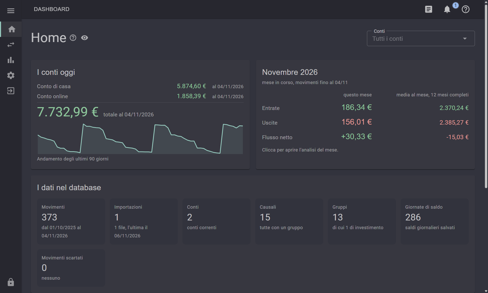
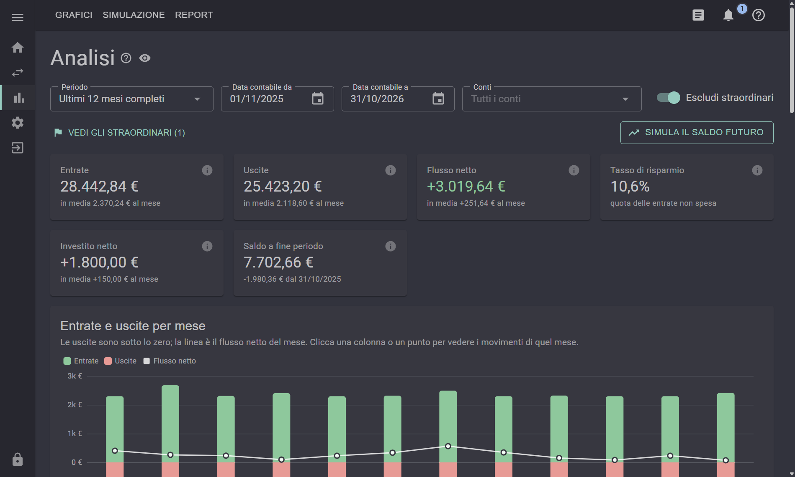
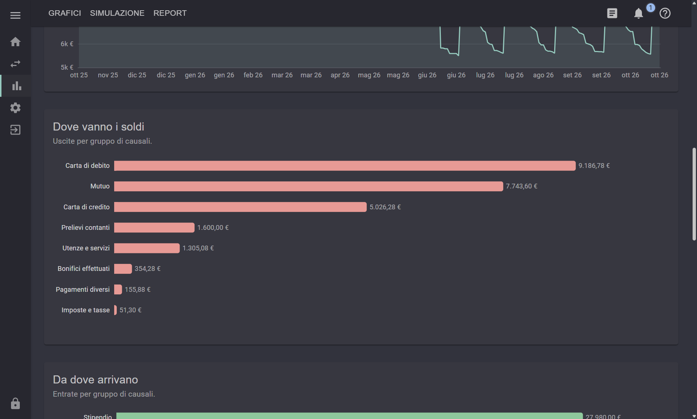
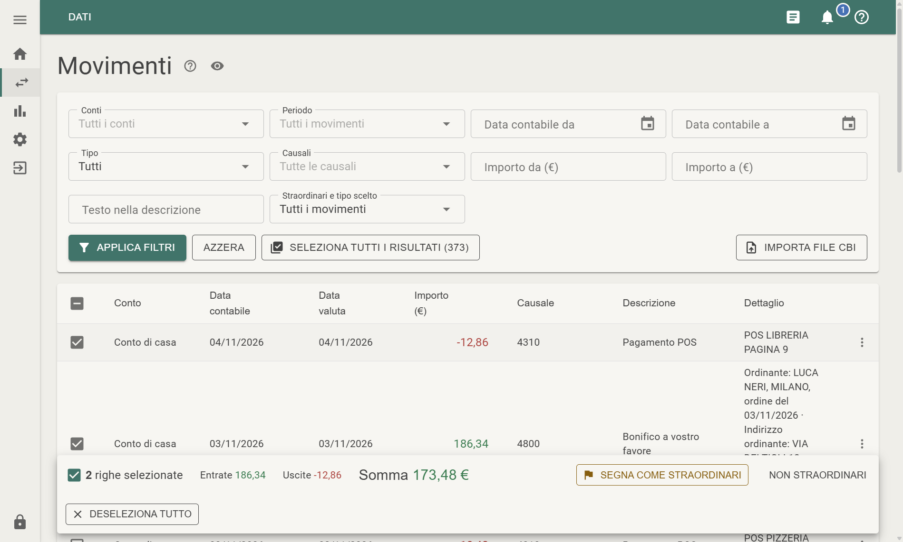
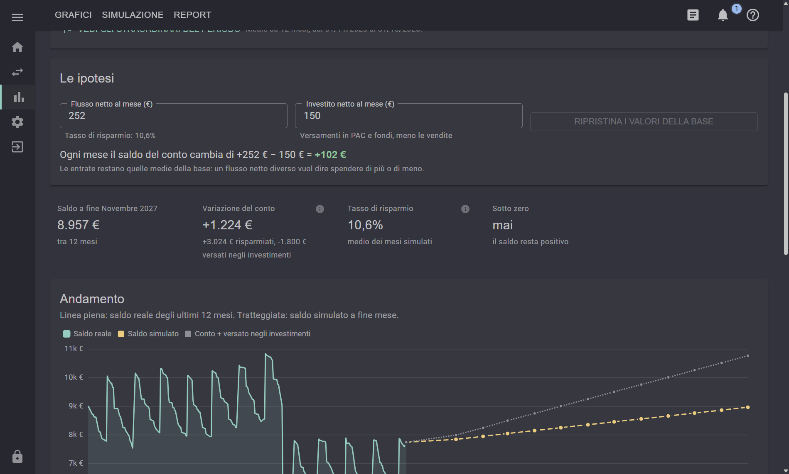
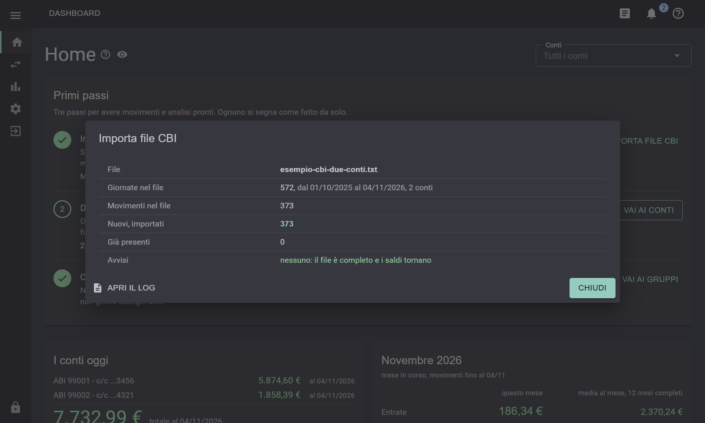

# EasyCashFlow

**Analisi del cash flow dei tuoi conti correnti, anche di banche diverse, a partire dai movimenti che esporti dall'home banking della tua banca.**

EasyCashFlow è un programma per Windows che legge i movimenti dei tuoi conti e mostra entrate, uscite, saldo e grafici, mese per mese.

I dati li prendi dalla tua banca: entri nell'**home banking**, vai ai **movimenti del conto** e li **esporti nel formato CBI**. Di solito c'è una voce come "Esporta movimenti" o "Saldi e movimenti", in cui si sceglie il formato CBI; per esempio in **Relax Banking**, l'home banking del gruppo Iccrea, sono le voci **Esporta CBI** ed **Esporta XML** del pulsante **Esporta** sopra la lista dei movimenti. I file CBI ("saldi e movimenti") sono i file standard con cui le banche italiane rendicontano i movimenti dei conti. Sono di due tipi, che seguono tutti e due gli standard CBI, ed EasyCashFlow li legge **entrambi**:

- **file di testo CBI** (`.txt`): il formato classico, righe di 120 caratteri, secondo lo standard **CBI-RND-001** "Rendicontazione saldi e movimenti di conti correnti";
- **file XML CBI** (`.xml`): la rendicontazione in XML, standard **STRN-MO-001** "Rendicontazioni XML" (v.00.01.02, costruito su ISO 20022 camt.053), con gli stessi movimenti e qualche informazione in più.

Il programma riconosce da solo il formato, e i due si possono alternare: lo stesso movimento non si duplica.

> **Compatibile al 100% con Relax Banking** (Home Banking del gruppo Iccrea): provato sui file veri, di testo e XML, che si importano con tutti i movimenti, le causali e i saldi, senza avvisi; i due formati danno esattamente gli stessi movimenti.

Siccome i file CBI sono uguali per tutte le banche, EasyCashFlow è anche un **aggregatore**: si importano i movimenti di più conti, anche in banche diverse, e li si analizza uno alla volta o tutti insieme, come se fossero un conto solo.

Funziona **senza internet e senza account**: è portable (si avvia da una cartella, senza installazione) e i dati restano sul computer, **cifrati** con una password.

> Versione **1.1.0**. Interfaccia e documentazione sono in italiano.
>
> **[Scarica EasyCashFlow](https://github.com/golia688/EasyCashFlow/releases/latest)**: lo zip pronto da usare, per Windows 10 e 11 a 64 bit. Non serve installare niente.

## Cosa fa

- **Importazione CBI**, del file di testo secondo la specifica CBI-RND-001 e del file **XML** secondo la STRN-MO-001 (ISO 20022 camt.053), anche alternati per gli stessi giorni: controlli formali sul file (un file che non è un export CBI si rifiuta senza salvare niente), quadratura e continuità dei saldi, deduplica dei movimenti già importati, riepilogo dell'importazione con gli avvisi raggruppati.
- **Più conti e più banche**: ogni conto si riconosce da solo dal file; Home, Movimenti e Analisi lavorano su un conto, su alcuni o su tutti. Le **causali CBI** (comuni a tutte le banche) danno un gruppo anche alle causali di una banca nuova.
- **Analisi**: entrate, uscite, flusso netto, tasso di risparmio, investito netto e saldo, con il dettaglio di ogni indicatore; grafici per mese e per gruppo di causali, spese ricorrenti e variabili, flusso cumulato, movimenti straordinari escludibili.
- **Simulazione del saldo** nei mesi futuri, **grafico personalizzato** dei movimenti scelti e **report Excel** con formule e grafici.
- **Sicurezza**: database cifrato (SQLCipher 4 con SQLite3 Multiple Ciphers), chiave protetta con Argon2id dalla password e da un codice di recupero, blocco per inattività, log senza dati in chiaro, importi nascondibili con un clic.
- **Notifiche**, **manuale** integrato, backup verificato, tema chiaro e scuro.

## Come si presenta

Le schermate sono fatte con i dati inventati di [`docs/esempi`](docs/esempi): due conti di due banche immaginarie, "Conto di casa" e "Conto online", con un anno di movimenti.

**Home**: il saldo di ogni conto e il totale, l'andamento, il mese confrontato con la media.



**Analisi**: i due conti insieme, con il movimento straordinario escluso (il condizionatore). Ogni scheda ha la spiegazione del calcolo e la sua pagina di dettaglio.



**Dove vanno i soldi**: uscite ed entrate per gruppo di causali; un clic su una barra apre i movimenti del gruppo.



**Movimenti**, nel tema chiaro: filtri, il conto di ogni movimento, la descrizione completa (qui un bonifico ricevuto con ordinante e indirizzo) e la somma delle righe selezionate.



**Simulazione del saldo** nei prossimi 12 mesi, partendo dalle medie del periodo.



**Importazione**: il riepilogo dopo aver letto il file CBI.



Altre schermate: [Analisi nel tema chiaro](docs/immagini/analisi-chiaro.png), [Aspetto](docs/immagini/aspetto-chiaro.png) (tema, colore principale, icone).

## Cosa serve

Per **usarlo**: Windows 10 o 11 a 64 bit, con Microsoft Edge WebView2 Runtime (già presente su Windows 11). Si scarica lo zip dalla pagina delle [versioni](https://github.com/golia688/EasyCashFlow/releases/latest), si estrae in una cartella del proprio utente (non in Programmi) e si avvia `EasyCashFlow.exe`: lo zip include .NET, non serve installare altro. Le istruzioni per installarlo sono in [`Distribuzione/LEGGIMI.txt`](Distribuzione/LEGGIMI.txt), le novità di ogni versione in [`Distribuzione/NOVITA.txt`](Distribuzione/NOVITA.txt).

Per **compilarlo**: .NET 10 SDK e Visual Studio con i carichi di lavoro "Sviluppo di applicazioni desktop .NET" e "Sviluppo ASP.NET e Web" (per i file Razor).

```
dotnet build EasyCashFlow.csproj
```

## Provarlo con dati inventati

[`docs/esempi/esempio-cbi-due-conti.txt`](docs/esempi/esempio-cbi-due-conti.txt) è un export CBI "saldi e movimenti" con **dati inventati**: due conti di due banche che non esistono (ABI 99001 e 99002), dal 01/10/2025 al 04/11/2026, con stipendio, mutuo, utenze, carte, un piano di accumulo, giroconti tra i due conti, qualche bonifico. È nel formato vero: si importa come un export della banca (Movimenti > Importa file CBI) e serve a provare il programma senza i propri dati. Gli stessi movimenti ci sono anche nella rendicontazione XML, [`esempio-cbi-due-conti.xml`](docs/esempi/esempio-cbi-due-conti.xml). Li genera [`genera-esempio-cbi.py`](docs/esempi/genera-esempio-cbi.py), sempre uguali (Python 3, nessun pacchetto in più).

La versione da distribuire si crea con il profilo `Properties/PublishProfiles/VersionePerProva.pubxml` (Visual Studio > Pubblica, oppure `dotnet publish -p:PublishProfile=VersionePerProva`): una cartella autonoma, con .NET incluso, in `bin\Pubblicazione\EasyCashFlow`.

## Com'è fatto

WPF + **Blazor Hybrid** (WebView2) + **MudBlazor** per l'interfaccia, **ECharts** per i grafici, SQLite cifrato per i dati.

| Cartella | Contenuto |
|---|---|
| `Pages/` | le pagine e i componenti Razor |
| `Services/` | importazione e lettore CBI, database, analisi, sicurezza, log, report |
| `Models/` | i tipi di dati (movimenti, conti, causali CBI, colori) |
| `Manuale/manuale.md` | il manuale per l'utente, incluso nell'eseguibile |
| `docs/` | la documentazione tecnica e la storia dello sviluppo |
| `wwwroot/` | la pagina host, ECharts e gli script |

La documentazione è in `docs/`: si comincia dallo [storico dello sviluppo](docs/00-storico-sviluppo.md), poi [stack](docs/01-architettura-stack.md), [menu](docs/02-architettura-menu.md), [avvio](docs/03-avvio-e-pagina-host.md), [servizi](docs/04-dependency-injection.md), [formato CBI](docs/05-formato-cbi.md), [analisi](docs/06-analisi.md), [sicurezza](docs/07-sicurezza.md) e [versionamento](docs/08-versionamento.md).

## Dati e privacy

I dati stanno nella cartella `dati` accanto al programma (database cifrato, file della chiave, preferenze) e non entrano mai nel repository, come gli export CBI e i log (`.gitignore`). Gli importi negli esempi della documentazione sono inventati.

I documenti tecnici del Consorzio CBI (CBI-RND-001, CBI-STD-001, STRN-MO-001 per l'XML) non sono inclusi: sono riservati e si scaricano, previa registrazione, dal portale del CBI. La documentazione descrive solo le posizioni dei campi del tracciato.

## Licenza

Il codice di EasyCashFlow è distribuito con la licenza [MIT](LICENSE).

Componenti di terze parti:

| Componente | Licenza | Dove |
|---|---|---|
| [ECharts](https://echarts.apache.org) 5.6.0 | Apache 2.0 | incluso in `wwwroot/lib/echarts` |
| [MudBlazor](https://mudblazor.com) | MIT | pacchetto NuGet |
| Blazor Hybrid per WPF (`Microsoft.AspNetCore.Components.WebView.Wpf`) | MIT | pacchetto NuGet |
| `Microsoft.Data.Sqlite.Core` | MIT | pacchetto NuGet |
| [SQLite3 Multiple Ciphers](https://github.com/utelle/SQLite3MultipleCiphers) (`SQLite3MC.PCLRaw.bundle`) | MIT | pacchetto NuGet |
| `Konscious.Security.Cryptography.Argon2` | MIT | pacchetto NuGet |
| [Markdig](https://github.com/xoofx/markdig) | BSD 2-Clause | pacchetto NuGet |
| Open XML SDK (`DocumentFormat.OpenXml`) | MIT | pacchetto NuGet |
